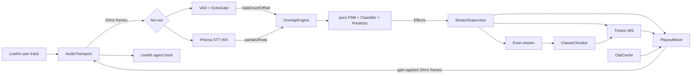

# OVERLAP — Architecture

> Full-duplex conversation on a cascaded Prisma → Evon → Timbre stack.
> Audience: coding agents and the human architect. Sections are numbered because `TASKS.md` `refs` point at them (`ARCHITECTURE.md#6`). **Read only the sections your task references.**

---

## 1. Purpose, scope, non-goals

OVERLAP is a drop-in Pipecat processor (plus a LiveKit transport) that makes a cascaded voice agent behave like a person on a phone call:

| Behaviour | Mechanism |
|---|---|
| Doesn't stop on "haan haan" | **Duck-then-decide**: duck to 30 % within one frame, classify within ≤ 400 ms, restore or yield |
| Yields in milliseconds on real interruption | Flush playout, cancel Timbre + Evon, truncate history to what was heard |
| Doesn't go silent during long user turns | **Agent backchannels** from a pre-synthesized, self-tagged clip cache (no LLM call) |
| Evon's memory matches reality | Assistant turn truncated to *played* words (word timings, else calibrated rate) |

**Non-goals (v1):** native full-duplex models, voice cloning (hook exists via `voice_id`, not wired), multi-party calls, a trained ML classifier (heuristics first, ML-ready feature interface).

**Hard rule:** the three pillars of logic — FSM, audio-buffer math, classifier heuristics — are **pure functions/data**. No sockets, no `asyncio`, no wall clock, no randomness without an injected seed.

---

## 2. Layering & module boundaries

```
overlap/
  core/            PURE. stdlib + numpy only. No asyncio, no I/O, no time.time().
    types.py         frozen dataclasses: AudioFrame, Tag, SttEvent, WordTiming, Verdict, Event, Effect, Tuning
    clock.py         Clock protocol, VirtualClock (test), MonotonicClock (prod), CancelToken
    audio.py         PCM<->float, RMS/dBFS, gain ramp, LoudnessTracker, EchoGate, EnergyVad
    playout.py       PlayoutLedger (queued/emitted/played sample accounting), flush
    truncate.py      words-played mapping, SpeakingRateEstimator, truncate_to_heard()
    lexicon.py       multi-script backchannel/stop/content/question lexicons + matcher
    classifier.py    OverlapClassifier: features -> Verdict (pure)
    fsm.py           transition(state, event, now) -> (state', [Effect])
    predictor.py     BackchannelPredictor: partials+energy+pauses -> BackchannelDue | None
    metrics.py       pure metric math (percentiles, rates) used by telemetry/bench
  ports/           Abstract interfaces ONLY (typing.Protocol). Depends on core.
    stt.py tts.py llm.py transport.py vad.py telemetry.py
  runtime/         asyncio orchestration. Depends on core + ports. NO third-party network libs.
    mixer.py         PlayoutMixer: pulls TTS audio, applies gain, injects tagged clips, bounded look-ahead
    supervisor.py    StreamSupervisor: cancel tokens, timers, effect executor, leak detection
    turn.py          TurnPipeline: Evon deltas -> ClauseChunker -> Timbre stream; history commit/truncate
    clip_cache.py    ClipCache: pre-synthesized backchannel clips (per lang)
    engine.py        OverlapEngine: wires everything; the only public runtime entrypoint
  adapters/        THE ONLY place with network/model deps. Depends on ports + core.
    gnani/prisma.py gnani/timbre.py gnani/evon.py gnani/wire.py
    vad_silero.py
  integrations/    Depends on runtime + adapters.
    livekit_transport.py   pipecat_processor.py
  telemetry/       collector.py (sink impl), jsonl writer
  bench/           eval corpus runner, threshold sweep, A/B harness
  config.py        default Tuning + env loading (keys only from env)
tools/             dag_lint.py, timed.py, record_wire.py
tests/             unit/ contracts/ invariants/ scenarios/ replay/ live/ fixtures/
docs/WIRE.md       Authoritative wire contract (produced by task T3.01)
```

### Import rules (enforced by `import-linter` **and** an AST purity test)

```
integrations → adapters → runtime → ports → core
                          bench → everything
```
- `core` may import: `dataclasses, enum, typing, math, re, unicodedata, collections, numpy`, optionally `regex`. **Forbidden:** `asyncio, socket, websockets, httpx, time (except via Clock), random (unseeded), livekit, pipecat, onnxruntime`.
- `ports` contain no logic; `runtime` never imports `adapters`; adapters never import `runtime`.
- Every third-party network/model client lives behind a port and is replaceable by a fake in `tests/`.

---

## 3. Runtime topology & concurrency



### 3.1 Two paths (key design decision)
- **Fast path (synchronous, allocation-light, never awaits network):**
  `mic frame → EnergyVad/Silero → EchoGate → FSM.transition → SetGain effect applied inline to PlayoutMixer`. This is what delivers the 20–40 ms duck. It runs inside the frame callback.
- **Slow path (async):** STT partials, classifier re-evaluation, Evon/Timbre streams, flush/cancel acks, timers. Effects other than `SetGain` are queued to the `StreamSupervisor`.

### 3.2 Epochs and cancel tokens (race protection)
- Every agent response has `(turn_id, epoch)`. Every in-flight stream (Evon, Timbre, clip synth) owns a child `CancelToken` of the turn's token.
- All events emitted by streams carry their `epoch`; the engine **drops stale-epoch events** (e.g. Timbre audio arriving after cancel).
- `YIELDED` entry cancels the turn token (cascades), bumps `epoch`, and holds until `YieldCompleted` (all cancels acked or the 100 ms hard timeout), then → `LISTENING`.

### 3.3 Time
All time is `int` nanoseconds from an injected `Clock`. Timers are *data* in FSM effects (`ArmTimer(name, deadline_ns)`); the supervisor realizes them via `clock.call_at`. **No `asyncio.sleep` / `time.sleep` anywhere in `core`/`runtime`.**

---

## 4. Core types (summary)

```python
class Tag(Flag): NONE=0; SELF_BACKCHANNEL=1; SELF_TTS=2   # agent's own audio markers

@dataclass(frozen=True, slots=True)
class AudioFrame: pcm: bytes; sample_rate: int; ts_ns: int; tags: Tag = Tag.NONE   # 20 ms, int16 mono

@dataclass(frozen=True, slots=True)
class WordTiming: word: str; start_ms: int; end_ms: int            # relative to start of the clause audio

@dataclass(frozen=True, slots=True)
class SttEvent: kind: Literal["partial","final"]; text: str; lang: str|None; conf: float|None
                ts_ns: int; words: tuple[WordTiming,...] = ()

class Label(Enum): BACKCHANNEL; INTERRUPT; SIDE_TALK; PENDING

@dataclass(frozen=True, slots=True)
class Verdict: label: Label; confidence: float; reason: str; overlap_ms: int; decided_at_ns: int

@dataclass(frozen=True, slots=True)
class Tuning: ...   # every constant in §10; single source of truth; tests import it, never hardcode
```
`Event` (FSM input) and `Effect` (FSM output) are frozen-dataclass unions — see §6.

Canonical internal audio: **16 kHz mono int16, 20 ms = 320 samples** for STT/VAD. Mixer output runs at the TTS/transport rate (`Tuning.out_rate_hz`, resampled at the adapter edge). Math uses float32 numpy only inside `core.audio`.

---

## 5. Ports (abstract interfaces)

All ports are `typing.Protocol`. Each has a reusable **contract test suite** in `tests/contracts/` that every implementation (fake *and* real adapter) must pass.

```python
# ports/stt.py
class SttStream(Protocol):
    async def send_audio(self, frame: AudioFrame) -> None: ...   # non-blocking; drops oldest on overflow (never blocks fast path)
    def events(self) -> AsyncIterator[SttEvent]: ...              # partials + finals, in order
    async def close(self) -> None: ...
class SttPort(Protocol):
    async def open(self, *, lang_hint: str | None, cancel: CancelToken) -> SttStream: ...

# ports/tts.py
@dataclass(frozen=True, slots=True)
class AudioChunk: pcm: bytes; sample_rate: int; epoch: int; words: tuple[WordTiming,...] = (); is_last: bool = False
class TtsStream(Protocol):
    async def send_text(self, clause: str, *, ssml: bool = False) -> None: ...
    async def finish(self) -> None: ...                           # no more text
    def chunks(self) -> AsyncIterator[AudioChunk]: ...
    async def cancel(self) -> None: ...                           # idempotent; MUST stop chunk delivery within 1 loop turn
class TtsPort(Protocol):
    async def open_stream(self, *, voice_id: str, lang: str, epoch: int, cancel: CancelToken) -> TtsStream: ...
    async def synthesize(self, text: str, *, voice_id: str, lang: str) -> AudioClip: ...   # batch; used by ClipCache

# ports/llm.py
@dataclass(frozen=True, slots=True)
class Message: role: Literal["system","user","assistant"]; content: str
class LlmStream(Protocol):
    def deltas(self) -> AsyncIterator[str]: ...
    async def abort(self) -> None: ...                            # idempotent; closes the HTTP/WS stream
class LlmPort(Protocol):
    async def stream(self, messages: Sequence[Message], *, epoch: int, cancel: CancelToken) -> LlmStream: ...

# ports/transport.py
class AudioTransport(Protocol):
    def user_frames(self) -> AsyncIterator[AudioFrame]: ...       # 20 ms cadence
    def send_frame(self, frame: AudioFrame) -> None: ...          # SYNC, non-blocking (fast path)
    def flush_output(self) -> None: ...                           # drop everything queued downstream of us
    def output_queue_ms(self) -> int: ...                         # bytes still queued in the transport
    def playout_position_ms(self) -> int | None: ...              # best estimate of what the user has HEARD; None => use calibrated offset

# ports/vad.py     class Vad(Protocol): def process(self, frame: AudioFrame) -> VadResult  (sync; ≤ 1 frame latency)
# ports/telemetry.py class TelemetrySink(Protocol): def emit(self, name: str, ts_ns: int, **fields) -> None   (sync, non-blocking; NullSink default)
```
Port rules: `send_frame`, `Vad.process`, `TelemetrySink.emit` are **synchronous and must not block**. `cancel()/abort()/close()` are idempotent.

---

## 6. State machine

Pure: `transition(state: FsmState, event: Event, now_ns: int, tuning: Tuning) -> tuple[FsmState, tuple[Effect, ...]]`.

States (spec states + one documented extension `THINKING`): `LISTENING, THINKING, SPEAKING, DUCKED, YIELDED, BACKCHANNELING`.

| From | Event | To | Effects |
|---|---|---|---|
| LISTENING | `EndOfTurn(final)` | THINKING | `StartResponse(turn_id, epoch)` |
| LISTENING | `BackchannelDue(clip)` | BACKCHANNELING | `PlayClip(clip, tag=SELF_BACKCHANNEL)`, `ArmTimer(bc_clip_end)` |
| BACKCHANNELING | `ClipDone` | LISTENING | — |
| BACKCHANNELING | `EndOfTurn(final)` | THINKING | `FadeOutClip(≤40ms)`, `StartResponse` |
| THINKING | `FirstAudioReady` | SPEAKING | `StartPlayout` |
| THINKING | `VadOnset` sustained ≥ `barge_in_thinking_ms` | LISTENING | `CancelResponse`, `MergeUserTurn` (cancelled turn text is prepended to the next final) |
| SPEAKING | `VadOnset` (not echo, not self-tagged) | DUCKED | `SetGain(0.3, attack)` **inline**, `OpenOverlapWindow`, `ArmTimer(classify_cap)` |
| SPEAKING | `AgentAudioDrained` | LISTENING | — |
| SPEAKING | `SttPartial` with content/stop word while user VAD active (late escalation, within `recheck_window_ms` of last BACKCHANNEL verdict) | DUCKED | as above (re-classify, skip attack) |
| DUCKED | `Verdict(BACKCHANNEL \| SIDE_TALK)` | SPEAKING | `SetGain(1.0, release)`, `CancelTimer`, `CloseOverlapWindow` |
| DUCKED | `Verdict(INTERRUPT)` | YIELDED | `FlushPlayout`, `CancelTts`, `AbortLlm`, `TruncateHistory(played_pos)`, `SetGain(1.0)` (silent), `CancelTimer`, bump epoch |
| DUCKED | `TimerFired(classify_cap)` | per fail-safe policy (§7.4) | emits the same effects as the verdict it forces |
| DUCKED | `AgentAudioDrained` | LISTENING | `SetGain(1.0)` |
| YIELDED | `YieldCompleted` | LISTENING | — |
| *any* | `TransportError` | LISTENING | cancel everything; telemetry |
| *any* | unknown/stale-epoch event | same | `Telemetry("fsm.ignored")` |

**Invariants (property-tested with Hypothesis, `derandomize=True`, `max_examples ≤ 50`):**
1. `transition` is total and never raises; unknown events are no-ops.
2. `DUCKED ⇒` a `classify_cap` timer is armed; leaving `DUCKED` always emits `CancelTimer`.
3. Entering `YIELDED` emits exactly one each of `FlushPlayout, CancelTts, AbortLlm, TruncateHistory` and bumps `epoch`.
4. After `YIELDED → LISTENING`, no effect with the old epoch is ever emitted again.
5. Gain is 1.0 in every state except `DUCKED`.
6. Backchannel clips are only started from `LISTENING`; events tagged `SELF_BACKCHANNEL` never trigger `SPEAKING → DUCKED`.
7. State and effects are deterministic functions of `(state, event, now, tuning)`.

---

## 7. Overlap classifier

Pure: `classify(features: OverlapFeatures, tuning) -> Verdict`. Re-invoked on (a) each `SttPartial`, (b) `VadOffset`, (c) soft tick at `classify_min_ms`, (d) hard cap at `classify_cap_ms`.

```python
@dataclass(frozen=True, slots=True)
class OverlapFeatures:
    overlap_ms: int            # since VadOnset (echo-gated)
    user_speaking: bool        # VAD still active
    rel_loudness_db: float     # user RMS − expected agent RMS at mic (LoudnessTracker); higher => more assertive
    partial_text: str | None; partial_age_ms: int | None; stt_conf: float | None; lang: str | None
    is_final: bool
```

### 7.1 Ordered rules (first match wins)
1. **Stop/contrast lexicon → INTERRUPT immediately.** "ruko", "nahi", "ek minute", "wait", "stop", "bas", "lekin", "par", "magar", "but", "aanal", … These are interjections that are **not** backchannels.
2. **Question or ≥ 2 content tokens, or 1 content token with overlap ≥ `content_min_overlap_ms` → INTERRUPT** (early exit, may fire before 250 ms).
3. **All tokens ∈ backchannel lexicon** (≤ `bc_max_tokens`, `overlap_ms ≤ bc_max_overlap_ms`) → **BACKCHANNEL** (confident once `overlap_ms ≥ bc_min_ms` or speech ended).
4. **No text yet** (STT partial latency): acoustic prior only after `classify_min_ms`:
   short overlap + speech ended → BACKCHANNEL; `rel_loudness_db ≥ assertive_db` and `user_speaking` → INTERRUPT; else PENDING.
5. **SIDE_TALK:** `rel_loudness_db ≤ sidetalk_db` and no lexicon hit and low `stt_conf` → SIDE_TALK (ignore). *Weakest rule — flagged in §15; kept conservative.*
6. **Hard cap** (`classify_cap_ms`): never returns PENDING. Fail-safe policy: still speaking with no backchannel-only evidence → INTERRUPT; otherwise BACKCHANNEL. `Tuning.failsafe_bias` can flip.

Verdicts are **revisable**: after BACKCHANNEL, content words arriving within `recheck_window_ms` escalate via the late-escalation transition (§6).

### 7.2 Lexicon
Data-driven, `overlap/core/lexicons/<lang>.yaml` (or Python dict) with fields `backchannel`, `stop`, `contrast`, `question`, each in **native script + romanized variants**. Normalization: NFC, casefold, strip punctuation/danda, collapse elongations ("haaan"→"haan"), romanized fuzzy match (edit distance ≤ 1 for tokens ≥ 4 chars). Seed (validate with native speakers — see §15): Hindi `haan, ji, haan ji, achha, theek hai, hmm, accha, ok`; Tamil `seri, aama`; Kannada `howdu`; Telugu `avunu, sare`; Malayalam `athe, sheri`; Bengali `hyan, accha, thik ache`; Marathi `ho, barobar`; Gujarati `ha, saru`; Punjabi `haanji, theek aa`; English `yeah, okay, right, mhm, uh-huh`. Code-switched partials are matched against the **union** of all lexicons, with `lang` used only as tiebreak.

### 7.3 Re-evaluation cadence
Classifier must be O(tokens) and allocation-light (≤ 0.2 ms per call; asserted in a microbenchmark).

### 7.4 Timeout safety
The `classify_cap` timer is a watchdog independent of the classifier: if no verdict by cap, the FSM forces §7.1 rule 6.

---

## 8. Playout, mixer, truncation

### 8.1 PlayoutMixer (runtime)
- Pulls `AudioChunk`s from the active `TtsStream`, re-frames to 20 ms, applies gain, calls `transport.send_frame`.
- **Bounded look-ahead:** the mixer never has more than `max_lookahead_ms` (60 ms) of un-sent audio committed downstream, otherwise gain changes can't take effect within a frame. Excess audio stays in the mixer's own queue (which `flush` can drop instantly).
- **Gain ramp:** linear per-sample ramp within a frame: attack ≤ 20 ms to 0.3; release `duck_release_ms` (150 ms) to 1.0. Click-free (asserted: max |Δsample| bound in test).
- **Clip injection:** `PlayClip(clip, tag)` mixes into the output when agent TTS is idle (backchannels only occur in `LISTENING`); frames are tagged `SELF_BACKCHANNEL`.
- **Flush:** `flush()` drops the mixer queue, calls `transport.flush_output()`, and returns the `PlayoutSnapshot` (see below) in the same call.

### 8.2 PlayoutLedger (core, pure)
Tracks, per `(turn_id, epoch)`: `samples_queued`, `samples_emitted` (sent to transport), and `played_ms(now, downstream_latency_ms)`:
```
played_ms = min(emitted_ms − transport_queue_ms − downstream_latency_ms, clause-audio-total)   # clamped ≥ 0
```
`downstream_latency_ms` comes from `transport.playout_position_ms()` if available, else `Tuning.assumed_downstream_ms` (calibrated per deployment; default 120).

### 8.3 Truncation to what the user heard (core, pure)
`truncate_to_heard(clauses: Sequence[ClauseAudio], played_ms, rate_est) -> HeardText`
1. Per sent clause, if **word timings** exist (Timbre): a word counts as heard iff its **midpoint** ≤ the clause-relative played position.
2. Else **calibrated rate**: `SpeakingRateEstimator` (EMA per language, units = grapheme clusters via `\X`) from completed clauses (`audio_ms / units`); heard units = `played_ms_in_clause / ms_per_unit`, then snapped **down** to a word boundary.
3. Clauses never started and un-synthesized remainder are dropped entirely.
4. Result committed as the assistant message, suffixed with `Tuning.truncation_marker` (default `" …"`; optionally a system note `"[interrupted by user]"`).
Accuracy target: ±1 word against ground truth in synthetic playout tests (INV-T1).

---

## 9. Agent backchannels

- **Predictor (core, pure):** `BackchannelPredictor.update(now, vad_state, partial, energy_ema) -> BackchannelDue | None`. Fires when **all** hold:
  user turn ≥ `bc_min_user_turn_ms` (3000); a pause of `bc_pause_min_ms..bc_pause_max_ms` (200–400) has just elapsed; the latest partial ends a **completed clause** (punctuation/danda/terminal-particle heuristics, no trailing conjunction) **or** energy has been falling for ≥ `bc_energy_fall_frames`; cooldown `bc_min_gap_ms` (4000) and `bc_max_per_min` (6) respected; no clip in flight; FSM in `LISTENING`.
- Clip choice: language of the latest partial; no repeats of the last 2 clips; seeded (deterministic) variation.
- **ClipCache (runtime):** at session start, pre-synthesizes N clips/lang via `TtsPort.synthesize` (in the agent's configured voice) and holds PCM at `out_rate_hz` in memory; on-disk cache keyed by `(voice_id, lang, text, ssml)`. Trigger→first-sample latency ≤ `bc_clip_start_ms` (50 ms) because no network is on the path.
- **Self-echo immunity:** clip frames carry `Tag.SELF_BACKCHANNEL`; the mixer registers a `self_audio_window` with the `EchoGate` for `[clip_start, clip_end + 150 ms]`, during which VAD onsets are attributed to echo/self unless `rel_loudness_db` exceeds the reference-adjusted threshold. User speech is **always** still forwarded to STT.
- **EchoGate (core):** compares mic RMS to the reference (frames we sent out) × adaptive estimated echo return loss; if mic ≤ ref·ERL·margin → treat as echo, no onset. This is a safety net; primary AEC is assumed at the client/transport (WebRTC AEC3). **Demo with headphones/AEC on.**

---

## 10. Latency & performance invariants

Every constant lives in `core.types.Tuning`; tests import the constants, never literals. Latencies are measured in **virtual time** by the hermetic harness (algorithmic delay) and by CPU microbenchmarks (compute cost). End-to-end/network numbers are measured live (§12).

| ID | Invariant | Value | Enforced by |
|---|---|---|---|
| INV-L1 | VAD frame hop | 20 ms (`frame_ms`); onset on **1 frame** | contract + unit |
| INV-L2 | Speech onset → gain-ducked frame leaves mixer | **≤ 40 ms** (≤ 1 frame detect + ≤ 1 frame apply) | invariants/test_duck_latency |
| INV-L3 | Duck gain / attack | 0.3 / ≤ 20 ms linear | unit (audio) |
| INV-L4 | Classification verdict (soft decision point → hard cap) | 250 ms → **≤ 400 ms** from onset; never PENDING at cap | invariants + classifier unit |
| INV-L5 | Verdict INTERRUPT → last agent sample emitted | **≤ 40 ms** (one frame) | invariants |
| INV-L6 | Verdict INTERRUPT → Timbre cancel sent + Evon abort issued | ≤ 1 event-loop turn, ≤ 5 ms virtual | scenario |
| INV-L7 | Post-cancel audio leakage (stale-epoch chunks reaching transport) | **0 frames** | scenario/property |
| INV-L8 | Release ramp after backchannel verdict | 150 ms to 1.0 | unit |
| INV-L9 | Mixer un-sent look-ahead committed to transport | ≤ 60 ms | unit/invariant |
| INV-L10 | Backchannel trigger → first clip sample | ≤ 50 ms (cached, no LLM, no network) | scenario |
| INV-L11 | Classifier call cost | ≤ 0.2 ms p99 | `bench` micro |
| INV-L12 | Per-frame fast-path cost (VAD→FSM→mixer) | ≤ 2 ms p99 | `bench` micro |
| INV-L13 | Fast path never awaits; `SttStream.send_audio` never blocks (bounded queue, drop-oldest) | — | AST + contract test |
| INV-T1 | Truncation accuracy | ±1 word vs ground-truth playout | unit |
| INV-S1 | Cancel/timer hygiene: after any scenario, 0 live tasks/streams/timers | — | `supervisor.assert_quiescent()` in every scenario |
| INV-B1 | Backchannel pacing | ≥ 4 s gap, ≤ 6/min | unit |
| INV-F1 | `make fast` wall-clock | **< 15 s** (enforced by `tools/timed.py 15`) | Makefile |

Quality targets (measured on the labelled corpus, §12): false-interruption rate ≤ 5 %, missed-interruption rate ≤ 5 %, echo-induced duck rate = 0 in scripted echo scenarios.

---

## 11. Hermetic test fixture strategy

Goal: **everything except `tests/live` runs offline, deterministically, in `make fast` < 15 s.**

1. **No network, ever:** `pytest --disable-socket` (pytest-socket) in `fast`/`check`; a canary test asserts `socket.socket()` raises.
2. **No real time:** `VirtualClock` (ns). `advance(ms)` fires due timers in order and then drains the event loop to quiescence (`await asyncio.sleep(0)` until no ready callbacks). Tests never `sleep`. A `run_virtual(coro)` helper hosts async tests.
3. **No real audio files:** `tests/fixtures/audio.py` synthesizes seeded signals (silence, tone bursts, noise bursts, "speech-like" amplitude-modulated bursts) with exact onset/offset/loudness. Golden audio, if any, is < 50 KB.
4. **Wire-frame mocks:** adapters are tested by **replaying JSONL wire transcripts** through an in-memory duplex (`FakeWebSocket`): each line `{"t_ms":int,"dir":"in|out","kind":"text|binary","payload"|"b64":…}`. The real transcripts are captured once by `tools/record_wire.py` in T3.01 (**live, human-triggered**) and committed (secrets scrubbed). Until then, hand-written fixtures carry `"assumed": true` and **adapters cannot be marked done on assumed fixtures**.
5. **Fakes implementing the ports** (`tests/fakes/`): `FakeStt` (scripted `(t_ms, SttEvent)` timeline, configurable partial latency), `FakeTts` (emits deterministic PCM chunks at real-time cadence in virtual time, with/without word timings, honours `cancel()`), `FakeLlm` (scripted deltas), `FakeTransport` (records every frame sent + timestamps, models downstream latency), `RecordingSink`.
6. **Scenario DSL:** `Scenario().agent_says("…").user_overlap(at_ms=1200, text="haan", dur_ms=300).expect_state(...).expect_no_flush()…` compiles to a timeline over fakes and returns a `Trace` (states, effects, frames out, telemetry). Golden scenarios (T2.04): backchannel "haan haan", interruption "ruko ek minute", contrast "haan lekin…", late escalation, side-talk, echo of own clip, user long turn → agent backchannel, interruption during THINKING, TTS-stale-chunk-after-cancel, STT drops mid-overlap, classifier timeout fail-safe.
7. **Test pyramid / markers:** `unit` (default, fast) · `contracts` · `invariants` (fast) · `scenarios` (fast ones) · `slow` (>1 s, excluded from fast) · `replay` · `live` (network, never in CI, human-triggered via `make live`) · `bench`. Per-test timeout 5 s (`pytest-timeout`); target ≤ 100 ms typical.
8. **Property tests:** Hypothesis with `derandomize=True`, `max_examples ≤ 50`, `deadline=None` handled by the global timeout.
9. **Mutation safety net:** invariants tests import `Tuning` values so retuning cannot silently weaken them.

---

## 12. Telemetry & evaluation

`TelemetrySink.emit(name, ts_ns, **fields)` events (JSONL on disk): `vad.onset`, `duck.applied`, `verdict`, `yield.flush`, `yield.cancel_sent`, `yield.truncate`, `bc.agent.fire`, `bc.agent.clip_start`, `fsm.transition`, `fsm.ignored`.

| Metric | Definition | Target |
|---|---|---|
| `t_duck` | onset → ducked frame out | p95 ≤ 40 ms |
| `t_verdict` | onset → verdict | p95 ≤ 400 ms |
| `t_stop` | onset → last agent sample, on real interruption | p50 ≤ 350 ms, p95 ≤ 450 ms (audible at 30 % until then) |
| `false_interruption_rate` | INTERRUPT verdicts on ground-truth backchannels ÷ backchannels | ≤ 5 % |
| `missed_interruption_rate` | non-INTERRUPT on ground-truth interruptions ÷ interruptions | ≤ 5 % |
| `bc_timing` | agent clip onset − pause start | 200–450 ms |
| `bc_rate` | agent backchannels per minute of user speech | ≤ 6 |
| `truncation_error_words` | |heard_words − truth| | ≤ 1 |
| `echo_false_duck` | ducks caused by own audio | 0 |

**Eval corpus:** labelled overlap events (`{audio|text-timeline, label, lang}`) in `bench/corpus/` — synthesized with Timbre for reproducibility plus any real recordings the human supplies. `bench.sweep` grid-searches `Tuning` thresholds and reports ROC-like tables.

**A/B naturalness:** same persona/prompt/Evon, stock Pipecat agent (stop-on-any-VAD) vs OVERLAP. Randomized, blind labels (A/B), scripted-caller scenarios + human raters (naturalness 1–5, "felt interrupted", "felt ignored", "thought the call dropped", forced preference). Stats: Wilson CI on preference, paired sign test. Output `reports/ab/`.

---

## 13. Wire-contract policy & Gnani adapters

> **This document deliberately does not assert Gnani endpoint paths, auth headers, or message schemas.** Base URL is `https://api.vachana.ai`; everything else must be captured from real traffic/official docs in **T3.01** and written to `docs/WIRE.md`, which becomes the only source of truth for adapters.

Adapter responsibilities:
- **Prisma (STT):** WS streaming; resample/frame to what the server wants; map server messages → `SttEvent`; language auto-detect surfaced in `lang`; reconnect with backoff + audio replay buffer (last ≤ 2 s); if streaming drops mid-overlap, engine falls back to acoustic-only classification (§14).
- **Timbre (TTS):** WS stream per response; `send_text(clause)`; chunks → `AudioChunk` (+ `WordTiming` if the service provides them — otherwise `words=()` and the calibrated rate path is used); `cancel()` sends the protocol's cancel/close and discards inbound audio.
- **Evon (LLM):** streaming completion → `str` deltas; `abort()` closes the stream.
- **Silero VAD:** local ONNX behind `Vad`; 16 kHz, 20 ms hop adapter (buffering to model window handled internally with ≤ 1-frame added latency; **fallback: `EnergyVad`**).
- Secrets only via env (`GNANI_API_KEY` etc., `.env.example`); never logged; fixtures scrubbed by `tools/record_wire.py`.

---

## 14. Failure handling & degradation

| Failure | Behaviour |
|---|---|
| Classifier exception | Log; degrade to **stock policy** (stop after `stock_stop_ms` of VAD-confirmed speech). Engine never crashes the call. |
| Prisma WS down | Acoustic-only classification (duration + loudness); reconnect in background. |
| Timbre cancel not acked | Mixer already flushed + epoch bumped ⇒ late chunks dropped; hard timeout 100 ms. |
| Timbre lacks word timings | Calibrated-rate truncation. |
| Evon stream error | Speak a canned apology clip from cache; return to LISTENING. |
| Transport/jitter-buffer unknown | Use `assumed_downstream_ms`. |
| Clip cache miss | Skip backchannel (never block on synth in the live path). |

---

## 15. Risks & open questions (for the human architect)

1. **Echo/self-trigger** is the #1 demo-killer; EchoGate is a safety net, rely on client AEC + headphones for the live demo.
2. **Prisma partial latency** may exceed the 250–400 ms window → acoustic prior (rule 4) and late escalation carry the load; measure in T3.02/T4.04.
3. **Timbre word timings** may not exist → calibrated-rate fallback is first-class, not an afterthought.
4. **Downstream jitter-buffer** hides true playout position; `assumed_downstream_ms` needs per-deployment calibration (T4.01).
5. **Lexicon coverage/accuracy** for 10 Indian languages needs native-speaker review; seed list is a starting point.
6. **Side-talk** has no reliable ground truth with heuristics alone; keep conservative (bias to BACKCHANNEL/INTERRUPT), consider ML later.
7. **Rate limits / concurrent WS limits** on `api.vachana.ai` unknown; T3.01 must document.
8. **A/B validity:** raters must not know which agent is which; scripted callers remove human variance but humans give the headline number — do both.
