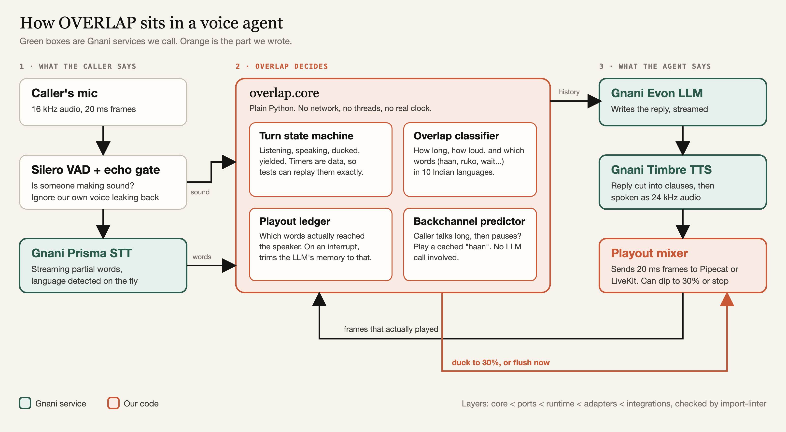
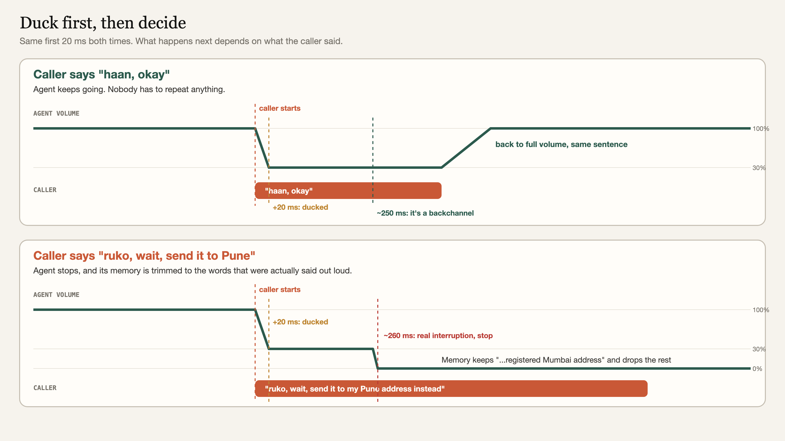

<h1 align="center">OVERLAP</h1>

<p align="center"><b>Full-duplex turn-taking middleware for Indian voice agents.</b></p>

<p align="center">
  <a href="docs/OVERLAP_Solution_Pitch.pdf"><b>1-Page Solution Pitch (PDF)</b></a> ·
  <a href="#why-voice-infra-instead-of-another-wrapper">Why Infra</a> ·
  <a href="#architecture--two-path-runtime">Architecture</a> ·
  <a href="#live-workbench">Live Workbench</a> ·
  <a href="#10-line-drop-in">Drop-In SDK</a> ·
  <a href="#benchmarks">Benchmarks</a> ·
  <a href="#quickstart">Quickstart</a>
</p>

<p align="center">Built on <b>Gnani Prisma</b> (STT), <b>Gnani Evon</b> (LLM), and <b>Gnani Timbre</b> (TTS) · Pipecat &amp; LiveKit ready.</p>

---

## Why voice infra instead of another wrapper

Most voice AI projects wrap an STT, LLM, and TTS into another support chatbot. **OVERLAP** targets the broken turn-taking layer inside the pipeline itself.

Standard pipelines wire Voice Activity Detection directly to `tts.cancel()`. Whenever a caller says *"haan"*, *"okay"*, *"achha"*, or coughs near a laptop mic, the agent kills its audio mid-word and restarts from scratch. Worse, because the LLM streams text much faster than audio leaves the speaker, an interrupted reply leaves unspoken sentences in conversation history—causing the model to hallucinate on the next turn.

| Live call event | Standard VAD (`vad = stop`) | OVERLAP runtime |
|---|---|---|
| Caller says `"haan"`, `"okay"`, `"achha"` | Kills TTS mid-word -> dead air -> restarts | Ducks output to **30%** within `20 ms`, classifies in `~240 ms`, restores `100%` |
| Room fan spike or single mic blip | Triggers false barge-in cut | Filtered by `-20.5 dBFS` floor + `60 ms` speech onset debounce |
| Caller actually stops the agent (`"ruko, wait..."`) | Stops playback, leaves full unplayed LLM text in memory | Yields within `~260 ms`, flushes PCM, truncates LLM history via `PlayoutLedger` |
| Caller speaks for `> 4 s` and pauses | Silence until full turn end | Injects pre-cached Timbre `"haan"` / `"achha"` clip in `O(1)` (`0` LLM calls) |

---

## Architecture & two-path runtime

<p align="center">
  
</p>

To keep audio responsive under network jitter, OVERLAP splits execution into two strict paths (detailed in [`ARCHITECTURE.md`](ARCHITECTURE.md)):

- **Fast path (synchronous, allocation-light, inside the `20 ms` audio callback):** `AudioFrame` → `EnergyVad` / `SileroVAD` + `EchoGate` → pure FSM `transition()` → inline `SetGain(0.30)` applied to `PlayoutMixer`. Never awaits network I/O.
- **Slow path (async `StreamSupervisor`):** consumes streaming Gnani Prisma partials/finals across 10 Indian languages, runs `OverlapClassifier`, manages epoch-scoped `CancelToken`s so cancelled Timbre/Evon chunks never leak across turns, and trims LLM history using `PlayoutLedger`'s exact emitted sample count.

<p align="center">
  
</p>

All state machine transitions, lexicon matching, duck envelopes, and memory slicing live in `overlap/core/`—plain Python (`stdlib` + `numpy` + `regex`) with no sockets, no threads, and an injected `Clock`, making timing bugs deterministically replayable. Layer boundaries (`core < ports < runtime < adapters < integrations`) are enforced in CI by `import-linter`.

---

## 10-line drop-in

Drop OVERLAP directly into a Pipecat pipeline while disabling Pipecat's built-in hard stop so the two don't fight:

```python
from overlap.config import load_config
from overlap.integrations.pipecat_processor import OverlapProcessor, disable_pipecat_interruptions

overlap_proc = OverlapProcessor(config=load_config())
pipeline = Pipeline([transport.input(), overlap_proc, stt, llm, tts, transport.output()])
task = PipelineTask(pipeline, params=disable_pipecat_interruptions(PipelineParams()))
```

- **Pipecat examples:** [`examples/pipecat_agent.py`](examples/pipecat_agent.py) vs baseline [`examples/stock_pipecat_agent.py`](examples/stock_pipecat_agent.py)
- **LiveKit transport:** [`overlap/integrations/livekit_transport.py`](overlap/integrations/livekit_transport.py)
- **Gnani wire spec:** [`docs/WIRE.md`](docs/WIRE.md) · **Playout delay calibration:** [`docs/CALIBRATION.md`](docs/CALIBRATION.md)

---

## Benchmarks

Evaluated across **240 labelled multilingual overlaps** spanning **10 Indian languages** (`bn`, `en`, `gu`, `hi`, `kn`, `ml`, `mr`, `pa`, `ta`, `te`), replayed directly through `OverlapClassifier`, `turn.fsm`, and `PlayoutLedger` (`python -m overlap.bench.replay`):

| Metric | Overall (240 cases) | Held-out split (60 unseen cases) | Target (`ARCHITECTURE.md §12`) |
|---|---:|---:|---|
| Classification accuracy | **235 / 240 (97.9%)** | **58 / 60 (96.7%)** | — |
| False interrupts on backchannels | **0** | **0 / 20 (0.0%)** | ≤ 5.0% |
| Missed real interruptions | **0** | **0 / 20 (0.0%)** | ≤ 5.0% |
| Decision latency (`t_verdict` p95) | **320.0 ms** *(train)* | **321.0 ms** | ≤ 400 ms |

On the held-out split, both errors were background `SIDE_TALK` (someone speaking nearby) conservatively classified as interruptions—zero backchannels were dropped and zero real interruptions were missed. Full per-language metrics and the 72-point parameter sweep are in [`reports/classifier_sweep.md`](reports/classifier_sweep.md).

---

## Live workbench

Launch the real-time browser workbench (`overlap/demo/`) with `make demo` (`http://127.0.0.1:8765`):

- **Live A/B Mode Switch:** toggle between `STOCK VAD` (kills agent on first sound) and `OVERLAP` (`0.30×` duck + classify) mid-conversation.
- **Dual Oscilloscope & Gain Rail:** inspects caller mic (`16 kHz` downsampled frames + `Prisma STT` partials), outbound `Timbre` frames, live gain attenuation, and real-time `PlayoutLedger` text slicing.
- **10 Indian Languages + Keyless Fallback:** supports Hindi, Tamil, Telugu, Kannada, Malayalam, Bengali, Marathi, Gujarati, Punjabi, and Indian English (`GNANI_API_KEY` + optional `GEMINI_API_KEY`, or runs locally without keys).

---

## Quickstart

Requires **Python 3.11** inside a Conda environment named `gnani` (verified by `Makefile`):

```sh
conda create -n gnani python=3.11 -y
conda activate gnani
pip install -e ".[dev]"
```

**Run offline / no API keys needed:**

```sh
make demo                          # live full-duplex web workbench at http://127.0.0.1:8765 (keyless fallback supported)
make fast                          # offline unit, contract, scenario & replay tests (network sockets disabled)
make check                         # ruff lint + mypy --strict + import-linter + full test suite
python -m overlap.bench.replay     # reproduce the 240-case 10-language confusion matrix
python -m overlap.bench.sweep      # reproduce the 72-candidate threshold sweep
make demo-ab                       # offline A/B comparison across 8 scripted caller scenarios
```

**Run with live Gnani & Gemini credentials (`api.vachana.ai`):**

```sh
cp .env.example .env               # set GNANI_API_KEY (and optionally GEMINI_API_KEY)
make demo                          # live Prisma STT -> Evon/Gemini LLM -> Timbre TTS workbench
pytest -m live                     # live wire smoke & round-trip integration tests
```

**Docker:**

```sh
docker build -t overlap-agent:latest .
docker run --rm -p 8765:8765 --env-file .env overlap-agent:latest
```

See [`docs/DEMO.md`](docs/DEMO.md) for headset / echo setup and offline fallback instructions.

---

## Repository structure & honest gaps

```text
overlap/
  core/            pure FSM, classifier, multi-script lexicons, playout ledger, truncation
  ports/           typing.Protocol interfaces (STT, TTS, LLM, VAD, transport, telemetry)
  runtime/         async OverlapEngine, PlayoutMixer, StreamSupervisor, O(1) ClipCache
  adapters/        Gnani Prisma STT / Evon LLM / Timbre TTS clients, Silero VAD
  demo/            full-duplex HTTP/WebSocket demo server & browser workbench UI
  integrations/    Pipecat OverlapProcessor + LiveKit AudioTransport
  bench/           240-case corpus loader, replay evaluator, threshold sweep, blind A/B harness
tests/             unit, contract, invariant (AST purity), scenario, replay & live tests
```

**Current limitations:**
- Accuracy metrics (`97.9%` overall, `96.7%` held-out) come from replayed labelled overlap audio rather than a large-scale field study with external callers.
- The blinded A/B naturalness harness (`overlap/bench/ab.py` and `overlap/bench/rating_cli.py`) is implemented and dry-run verified, but human MOS ratings have not been collected yet.
