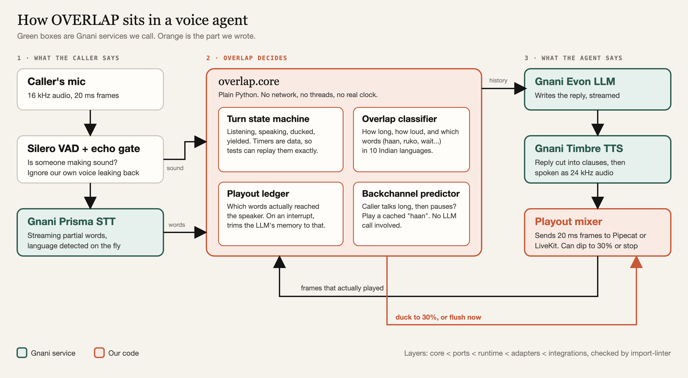
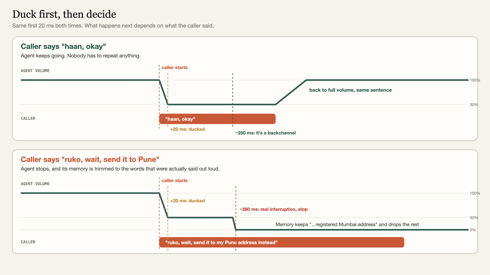

<h1 align="center">OVERLAP</h1>

<p align="center"><b>A voice agent that knows "haan" doesn't mean "stop".</b></p>

<p align="center">
  <a href="docs/OVERLAP_Solution_Pitch.pdf"><b>One-page pitch (PDF)</b></a> ·
  <a href="#how-it-works">How it works</a> ·
  <a href="#run-it-yourself">Run it yourself</a> ·
  <a href="ARCHITECTURE.md">Full architecture</a> ·
  <a href="docs/WIRE.md">Gnani wire notes</a>
</p>

<p align="center">Built on Gnani Prisma (speech-to-text), Evon (LLM) and Timbre (text-to-speech).</p>

---

## The problem

I called a support line about a shirt I'd bought. Turns out it was an AI voice agent. It was going fine until I said "okay" while it was talking. It cut itself off mid-word, went silent, and then started its whole answer again from the top.

That's how most voice agents work. The voice activity detector hears you, so the agent's audio is killed. A "hmm", a cough, a "haan" all count as you taking the floor. Then you both sit there going "no no, go ahead".

There's a second problem nobody sees. The LLM writes its answer way faster than the voice can say it. If you interrupt halfway, the model still thinks it said everything, so on the next turn it acts like you heard sentences you never did.

## What OVERLAP does

It sits between the caller's mic and the agent's speaker and handles three things.

**1. Turn down, don't stop.** When the caller starts talking over the agent, the volume drops to 30% within one 20 ms frame and the agent keeps going. About a quarter of a second later we know what the sound was. A "haan" or "okay": volume comes back up and the sentence finishes. A "ruko" or "wait": the agent stops.

**2. Remember only what was actually said.** We track exactly which words reached the speaker. When you cut in, the LLM's history is trimmed to that point, so it never "remembers" something you didn't hear.

**3. Nod along.** When the caller is explaining something long and pauses for a moment, the agent drops in a short "haan" or "achha" from a small cache of pre-recorded Timbre clips. No LLM call, so it lands on time.

Word lists cover 10 languages: Hindi, Tamil, Telugu, Kannada, Malayalam, Marathi, Bengali, Gujarati, Punjabi and Indian English.

## How it works

<p align="center">
  
</p>

The decision logic in `overlap.core` is plain Python with no network, no threads and no real clock, so every timing case can be replayed in a test.

<p align="center">
  
</p>

## Numbers

240 labelled cases across the 10 languages, replayed through the real classifier and state machine (not a copy of the logic).

| | Result |
|---|---|
| Overall accuracy | 235 / 240 (97.9%) |
| Held-out split (60 cases, never used for tuning) | 58 / 60 (96.7%) |
| Backchannels that stopped the agent | 0 |
| Real interruptions that were missed | 0 |
| Decision time, held-out p95 | 321 ms |

On the held-out set the only two mistakes were side-talk (someone talking to someone else in the room) that got read as interruptions. The full breakdown by language and the threshold sweep are in [`reports/classifier_sweep.md`](reports/classifier_sweep.md).

## Add it to a Pipecat agent

```python
from overlap.config import load_config
from overlap.integrations.pipecat_processor import OverlapProcessor, disable_pipecat_interruptions

overlap_proc = OverlapProcessor(config=load_config())
pipeline = Pipeline([transport.input(), overlap_proc, stt, llm, tts, transport.output()])
task = PipelineTask(pipeline, params=disable_pipecat_interruptions(PipelineParams()))
```

Pipecat's own interruption handling is switched off so the two don't fight. There's also a LiveKit transport (`overlap/integrations/livekit_transport.py`). Working examples are in [`examples/pipecat_agent.py`](examples/pipecat_agent.py), plus [`examples/stock_pipecat_agent.py`](examples/stock_pipecat_agent.py), the "stop on any sound" version to compare against.

## Run it yourself

You need Python 3.11 in a conda env called `gnani`. The Makefile checks for that.

```sh
conda create -n gnani python=3.11 -y
conda activate gnani
pip install -e ".[dev]"
```

**No API keys needed for any of this:**

```sh
make fast                          # offline tests, network sockets disabled, under 15 s
make check                         # lint, types, layering rules, all tests
python -m overlap.bench.replay     # the 240-case evaluation, prints the confusion matrix
python -m overlap.bench.sweep      # re-runs the threshold sweep
make demo                          # blinded A/B setup check across the 8 scripted caller scenarios
```

**With Gnani keys** (live tests hit `api.vachana.ai`):

```sh
cp .env.example .env               # then fill in GNANI_API_KEY
pytest -m live
```

`docs/DEMO.md` covers headphones and echo setup, and `docs/CALIBRATION.md` covers tuning the playout delay.

## What's not done

- The blind A/B listening test is built (`overlap/bench/ab.py`, `rating_cli.py`) but we haven't run it with real people yet, so there's no human naturalness score.
- The accuracy numbers come from replayed test cases, not a live call with strangers.
- `examples/pipecat_agent.py` shows how to wire things up. It isn't a one-command phone agent.

## Where things live

```text
overlap/core/          decision logic: state machine, classifier, lexicons, playout ledger
overlap/ports/         interfaces for STT, TTS, LLM, VAD, transport
overlap/runtime/       async engine, mixer, supervisor, clip cache
overlap/adapters/      Gnani Prisma / Evon / Timbre clients, Silero VAD
overlap/integrations/  Pipecat processor, LiveKit transport
overlap/bench/         corpus, replay, sweep, A/B harness
tests/                 unit, contract, replay and live tests
```

The layers only import downward (`core` < `ports` < `runtime` < `adapters` < `integrations`), and `make check` fails if that's broken.
